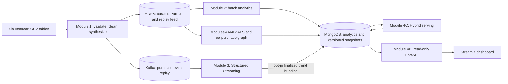

# Instacart market basket analysis

A Big Data Storage and Processing course project that combines historical
purchase analytics with replayed purchase-event trends and product
recommendations. It uses Python, Apache Spark, HDFS, Kafka, MongoDB,
GraphFrames, FastAPI, Streamlit, Docker Compose, and an isolated Kubernetes
demonstration.

Start with the synthetic dashboard below, then use the
[documentation index](docs/README.md) for module operations and acceptance.
The [project status](docs/progress.md) separates implemented capabilities,
historical results, and verification still required.

## Architecture

The project follows Lambda Architecture: a batch layer computes historical
analytics and recommendation inputs, a speed layer computes event-time trends,
and a serving layer exposes versioned results.



| Module | Responsibility |
|---|---|
| **1 — Ingestion and storage** | Validate and clean six related source tables, generate deterministic replay events, stage data in HDFS, and publish keyed purchase events to Kafka. |
| **2 — Batch analytics** | Compute prior-history product, department, user and time-pattern analytics; publish MongoDB metrics and descriptive HDFS user features. |
| **3 — Speed layer** | Validate and deduplicate Kafka events within watermark state, aggregate finalized event-time trends, and publish rows, optional immutable bundles, and telemetry. |
| **4A — ALS** | Fit implicit-feedback recommendations from prior interactions and evaluate against held-out baskets. |
| **4B — Product graph** | Build prior-basket co-purchase relationships, weighted degree, and GraphFrames PageRank while retaining isolated catalog products. |
| **4C — Hybrid** | Read ready batch generations and eligible immutable trend bundles, rank bounded candidate sets, and publish versioned per-user recommendations. |
| **4D — API and dashboard** | Expose bounded read-only views of recommendations, batch metrics, trends and registered evidence. Streamlit accesses data through FastAPI. |

Module 2's user features are descriptive; they do not feed Hybrid ranking.
Module 3 also writes mutable `realtime_trending` rows. Hybrid and the trends
API consume the separate immutable `realtime_trending_windows` bundles, whose
publication must be explicitly enabled.

## Dataset and source relationships

The input is the public **Instacart Market Basket Analysis** dataset:
`orders.csv`, `order_products__prior.csv`, `order_products__train.csv`,
`products.csv`, `aisles.csv`, and `departments.csv`. Order-product facts join
to orders by `order_id` and to the catalog by `product_id`; the catalog refers
to aisle and department dimensions. Prices, revenue, clicks, and views are
outside this dataset.

The dataset has no absolute purchase timestamps. Generated timestamps are
**Synthetic event time for replay simulation**. The ordinary feed includes
both prior and train purchases and omits `eval_set` from Kafka messages, so
an event-time cutoff does not make it safe for official-train evaluation.
Batch analytics, ALS fitting, and graph construction use prior interactions;
official train baskets are evaluation truth.

See the [requirements baseline](docs/Proposal.md#4-dataset) and
[Module 3 contracts](docs/module3-contracts.md) for schemas and provenance.

## Run it

For a first demonstration, use host Python 3, a running Docker daemon, Docker
Compose with build support, registry access or cached images, and free
loopback ports 18000 and 18501. No source dataset, HDFS, or Kafka service is
needed for this synthetic serving demo.

```bash
git clone https://github.com/mihikari29/instacart-market-basket-analysis.git
cd instacart-market-basket-analysis
docker compose config --quiet
python3 scripts/dashboard/demo.py up
```

Open <http://127.0.0.1:18501>. The command builds the API/UI images, starts an
isolated MongoDB on disposable tmpfs, publishes fixture data, and checks API
responses. Retain the printed run ID; replace `RUN_ID` below with that value
to stop only this demo and discard its data:

```bash
python3 scripts/dashboard/demo.py down RUN_ID
```

The [Docker guide](docs/docker.md) owns image builds, dependency environments,
full-data preparation, module commands, and cleanup boundaries. Core Spark
validation uses Spark 3.5.5 and Java 17; API, UI, and browser dependencies have
separate manifests. The root Compose project uses persistent HDFS and MongoDB
volumes. Review their ownership before starting or stopping it; do not prune
shared resources to clean up a demo.

The [Kubernetes guide](docs/kubernetes.md) describes a separate run-scoped
serving tier, processing Jobs, acceptance checks, and explicit teardown.
Kubernetes Spark work runs in local mode inside Jobs. Compose can run a
standalone Spark master and worker on one host. These development topologies
do not establish multi-host fault tolerance or production capacity.

## Configuration and scoring

[`config/pipeline.yaml`](config/pipeline.yaml) is **partially consumed**.
Its comments distinguish active settings from declarations awaiting runtime
wiring; changing a value there does not necessarily change a standalone CLI.

| Consumer | Effective configuration |
|---|---|
| Module 1 and standalone Module 2/3/4 CLIs | Module-specific arguments and `Config` defaults; supported root, master and MongoDB settings also read environment variables. Explicit options take precedence for those settings. They do not load every pipeline YAML field. |
| Module 4 ALS tuning | [`tuning.py`](src/module4/tuning.py) reads local `models.als` fit parameters for the first trial candidate. CLI arguments still control trial and pilot limits; YAML `max_trials` alone does not set the standalone CLI budget. |
| Hybrid serving CLI | Uses `HybridRankingConfig(lambda_weight=...)`, default lambda 0.7 and graph weight zero. It does not call `from_pipeline_config()`. |
| Kubernetes tasks | [`config.py`](scripts/k8s/config.py) loads operational settings and forwards selected synthesis, model and streaming values. Job manifests still own CPU/memory allocations; YAML window/trigger declarations are not forwarded. |

Standalone streaming defaults are 30-minute short counts within 120-minute
windows, a five-minute slide, a ten-minute watermark, and a ten-second trigger.
Results are finalized-window rankings, not an open-window leaderboard.

The default Hybrid CLI blends normalized ALS and trend scores. Missing-source
and cold-user rules determine the effective blend and candidate set. The pure
ranker also supports an explicitly supplied three-way configuration with
PageRank, but YAML weights do not activate that path in the serving CLI.
See [Hybrid contracts](docs/module4-plan.md#module4c-spec).

Kubernetes task-level receipt reuse follows `execution.resume_policy`;
`enabled` and `strict` currently permit reuse, while `disabled` bypasses it.
This does not provide automatic coordinator recovery or prove checkpoint
compatibility. See [configuration and recovery limits](docs/progress.md#configuration-and-recovery-boundaries).

## Testing and current limits

Use the [Docker validation commands](docs/docker.md#validation-commands) for
repository fixtures, separate UI tests, and isolated API/MongoDB validation.
The [acceptance guide](docs/acceptance.md#phase-1) records the host offline
selection and exclusions; service-backed tests require their designated
isolated environment. Dashboard UI tests and offline Kubernetes fixtures
remain independently runnable.

Local regression and fixture checks have passed, but live integration,
browser acceptance, Kubernetes B2/B3/B4, full-data processing, checkpoint
recovery, and executor-layout experiments still need fresh evidence for the
selected source. Historical benchmarks and cached package checks do not close
those gates. Historical ALS Recall@10 trailed personal frequency; the
synthetic Hybrid demonstrations do not establish recommendation quality.
See [status and limitations](docs/progress.md).

## Repository layout

| Location | Purpose |
|---|---|
| [`src/common/`](src/common/) | Shared runtime, validation, provenance, and Spark helpers. |
| [`src/module1/`](src/module1/), [`src/module2/`](src/module2/), [`src/module3/`](src/module3/) | Ingestion, batch, and streaming packages. |
| [`src/module4/`](src/module4/) | ALS, evaluation, graph, tuning, and publication; `hybrid/` and `dashboard/` own serving and presentation. |
| [`scripts/`](scripts/) | Module 2/3/4 Compose wrappers, dashboard tools, experiment harnesses, and Kubernetes orchestration. |
| [`deploy/`](deploy/) | Dashboard dependency manifests, isolated demo Compose, and Kubernetes assets. |
| [`tests/`](tests/), [`.github/workflows/`](.github/workflows/) | Offline fixtures, integration/UI tests, packaging, and acceptance workflows. |

<a id="module4-package-paths"></a>

Canonical imports include `src.module4.hybrid.service` and
`src.module4.dashboard.api`; the ASGI app is `src.module4.dashboard.api:app`.
The [documentation index](docs/README.md) links the detailed contracts and
operator guides.

## Requirements baseline

[`docs/Proposal.md`](docs/Proposal.md) is the repository requirements baseline;
its header uses IT4931, while the current coursework context identifies
IT4043E. No authoritative revised proposal is included here. Confirm the course
identifier and approved version before changing that baseline. Existing
runtime identifiers remain unchanged.

Bronze/Silver/Quarantine storage layers, distributed cleaning/ETL, and DuckDB
comparisons are not implemented. Revised-scope requirements need to be
reconciled with the authoritative proposal rather than marked complete from
this implementation.
