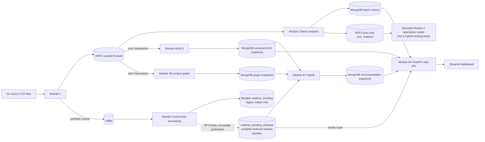

# Implementation and design ledger

This ledger records the system's interfaces, important implementation choices and the reasons behind them. It describes current source behavior and known limits, rather than replaying review milestones. The approved [Proposal](Proposal.md) remains the requirements baseline; dated measurements remain immutable in the [evidence archive](evidence/README.md).

## 1. Architecture and module boundaries

The project separates data acquisition and preparation (Module 1), historical processing (Module 2), event-time processing (Module 3), recommendation and graph computation (Modules 4A/4B), their combined serving snapshot (Module 4C), and read-only presentation (Module 4D). HDFS stores curated Parquet and staged feed artifacts. Kafka provides replayable product events. Spark performs batch and streaming work. MongoDB stores versioned serving outputs and trend data. FastAPI is the only database boundary used by Streamlit.

The Module 2 feature reader is a bounded descriptive lookup, separate from Hybrid ranking and the API's Mongo-backed routes. The API reads batch metrics and ALS snapshots directly; Hybrid consumes ready ALS/graph snapshots and, when enabled, immutable finalized trend bundles. The trends API also reads those optional bundles. The legacy mutable trend collection is a separate output and is not a Hybrid source. These interfaces retain distinct source scope and version identities. A/B publication does not become a single transaction merely because both snapshots are required by readiness. The API returns the source identities used by each view so a caller can distinguish a current snapshot from an unavailable one.

## 2. Module 1 — raw contracts, cleaning and publication

### 2.1 Source tables and validation order

The input contract is exactly six CSV tables:

| Table | Primary/unique identity | Relationships |
|---|---|---|
| `orders` | `order_id` | `user_id` groups order sequences. |
| `order_products__prior` | unique `(order_id, product_id)` | `order_id` → `orders`; `product_id` → `products`. |
| `order_products__train` | unique `(order_id, product_id)` | Same keys as prior, but held out for recommendation evaluation. |
| `products` | `product_id` | `aisle_id` → `aisles`; `department_id` → `departments`. |
| `aisles` | `aisle_id` | Product classification dimension. |
| `departments` | `department_id` | Product classification dimension. |

The cleaner requires every table, rejects duplicate header names and any missing or unexpected column, and initially reads values as strings. It validates canonical positive integer text (allowing zero-padded hour text only for `order_hour_of_day`), numeric ranges, allowed `eval_set` values, unique identifiers, order/user relationships, prior/train correspondence, foreign keys, and raw-value domains before numeric coercion. Diagnostics identify table, row and field without echoing arbitrary source values. Validation errors are bounded to a small set of messages.

`add_to_cart_order` values must be positive, unique within an order, and exactly contiguous from 1 through N. This is stronger than checking only uniqueness or maximum position; gaps would invalidate event sequence and basket interpretation. The cleaner rejects malformed or empty source files before creating a new publication.

### 2.2 Cleaning decisions

- A missing `days_since_prior_order` is accepted only for the first order and becomes `0.0`.
- A source value of 30 is a cap, not necessarily an exact interval. For a later order, the cleaner chooses `30 + ((current_dow - previous_dow - 2) % 7)`, the minimum compatible gap in `[30, 36]`, and then checks the gap modulo seven against weekday progression.
- Product names replace nonbreaking spaces, collapse whitespace and trim outer whitespace.
- Integer, boolean, category and string columns are converted to compact dtypes only after raw validation. The full catalog remains present, including products without prior interactions.
- `eval_set=test` rows remain represented in cleaned order metadata but are outside generated prior/train purchase events.

The weekday-consistent reconstruction is a simulation aid; it cannot recover the true uncapped interval. Generated calendar dates are not source facts.

### 2.3 Safe local publication

The cleaner writes the six expected Parquet files and `.it4931-clean-output.json` into a sibling staging directory. Before replacement it rejects symlink traversal, raw/output overlap, non-directory output paths, unknown entries and invalid ownership manifests. It renames a previously recognized publication to a temporary backup, renames the complete staged directory into place, restores the backup if promotion fails, and removes only the expected files from a validated backup. It does not recursively delete arbitrary paths. The sequence assumes one writer; it is not a distributed or concurrent-writer transaction.

### 2.4 Synthetic event-time algorithm

The source tables contain order sequence number, weekday and hour, not absolute timestamps. The generator starts from Monday 2024-01-01 and computes a per-user anchor using a stable hash of `(seed, "user-anchor-week", user_id)` within the selected scatter window. It accumulates cleaned inter-order gaps, adds the recorded order hour, and derives minute and second from stable order-keyed namespaces in uniform mode. Deterministic/hash mode derives order time from order identity. A stable namespace hash and SplitMix64 values select within-cart intervals keyed by `(seed, "event-item-gap", order_id, add_to_cart_order)`.

`SyntheticConfig` defaults to seed 42, 13 scatter weeks, uniform order-time sampling and exponential within-cart gaps with mean 30 seconds clipped to 5–120. Other declared scenarios are `mobile-fast` (20 seconds, 3–90), `desktop-browse` (40 seconds, 10–240), `uniform` (15–50) and `deterministic` (hash time mode). Supported scatter windows are 1, 4, 13, 26 and 52 weeks. `--batch-users` limits processing batch size (default 20,000), not the event population or generated values.

The first item in a basket has zero within-order delay; subsequent item timestamps accumulate sampled intervals. A per-user chronological pass shifts an order forward when its first event would not exceed the previous order's final event by at least one second. This establishes strict monotonic event time along `(user_id, order_number, add_to_cart_order)` while preserving the relative sequence. A manifest records configuration, determinism keys, batch-size invariance, counts, date span, daily distribution and monotonicity count.

The Parquet event output also records `order_number` and `synthetic_date`. The Kafka serializer's contract has 13 fields: `event_id`, `order_id`, `user_id`, `product_id`, `add_to_cart_order`, `reordered`, `aisle_id`, `department_id`, `order_dow`, `order_hour_of_day`, `event_time_epoch_ms`, `event_time_iso` and `ingestion_time_epoch_ms`. The producer uses `user_id` as message key and assigns ingestion time at send time. It does not send `eval_set` or `synthetic_date`. The normal feed includes prior and train orders, so consumers cannot reconstruct a prior-only stream from that payload.

### 2.5 HDFS and Kafka staging

HDFS staging retains raw inputs and their source receipt separately from curated Parquet. The default root is `/instacart`; isolated runs can supply a run-owned root. The principal paths are:

| Data | HDFS path under the selected root | Publication/ownership note |
|---|---|---|
| Raw input | `raw/<table>/<source-file>.csv` for each of the six source tables. | The six-file source receipt is retained as separate input/run evidence; the raw HDFS area stores the CSVs. |
| Curated orders | `curated/orders/orders.parquet` | Uploaded as an individual curated table. |
| Curated interactions | `curated/order_products_prior/order_products__prior.parquet`; `curated/order_products_train/order_products__train.parquet` | Counted and hashed in `curated/_sources.json`. |
| Curated dimensions | `curated/dimensions/{products,aisles,departments}/<table>.parquet` | Each table is uploaded at its canonical dimension path. |
| Partitioned replay interactions | `curated/interactions/` with date partitions and `_handoff.json`. | Uploaded under a temporary sibling; promoted through a separate staging/backup/rename sequence, with rollback on failure. |
| Descriptive user features | `features/user_features/` | Module 2 writes this prior-only handoff; Module 4 reads a bounded row. |
| ALS inputs and model area | `features/als_interactions/`; `models/als/` | Module 1 creates the expected path placeholders; model jobs own their output content. |

Staging verifies the produced receipt and promotes the interaction handoff through its own staging/backup/rename procedure. This boundary prevents a Module 1 run from claiming that every HDFS location is one atomic publication.

Kafka replay is separate from file generation and staging. Finite replay requires producer success, receipt/count reconciliation, and committed terminal offsets across partitions. A bounded consumer reaching end of current input does not prove the event-time tail has finalized.

## 3. Module 2 — batch analytics, features and performance

### 3.1 Input checks and analytics scope

Module 2 checks source receipts and handoff metadata, counts, nulls, keys, foreign keys, domains, date partitions, and exact fact/event multisets with Spark set operations. Its primary history join matches prior facts to order attributes by `order_id`, then broadcasts the product dimension for the `product_id` enrichment. It does not independently compute SHA-256 equality for every staged table. Its optional `--source-events` check compares a supplied local event feed against its receipt; Module 4 staged-Parquet hashing is a separate check.

Historical analytics use `order_products__prior`. The `user_features` output contains `user_id`, `order_count`, `purchase_count`, `unique_products`, `reorder_rate` and `avg_basket_size`, with `module2_run_id`, `feature_scope=prior_only`, and `generated_at_utc`. The Module 4 feature reader validates the exact contract, performs a bounded user lookup and detects duplicate rows. These descriptive features are not ALS fit inputs; an absent row does not by itself prove an unknown user.

Analytics include product/department aggregates, weekday and hour distributions, user feature extraction and department-hour pivot/unpivot reconciliation. Date partition filters, exact plan choices and result equality are recorded with benchmark evidence.

### 3.2 Mongo publication and reader identity

Writers use bounded bulk batches and run-owned temporary collections, validate the expected document set and indexes, then promote a collection by rename. Product collection indexes are created on the replacement before it is promoted. Promotion is atomic for one same-database collection rename, not for a set of product, department, feature or metric collections. Readers must use run/version IDs and readiness contracts rather than assume a cross-collection transaction.

### 3.3 Benchmark design and rationale

The local comparison runs `local[1]` and `local[2]` in separate Spark processes against the same measured source and records output equality, source identity, configuration, bytes/rows, wall time, plan, event log and shuffle/task information. The standalone executor experiment is separate: it attaches to an existing master, uses declared executor layouts, and verifies actual registered executor IDs/host/ports and allocated resources through Spark REST evidence. Neither mode creates a cluster or assumes the requested memory is the allocated heap. A benchmark result is valid only with its input, output, code/runtime, arm configuration and trial records.

The join benchmark holds data and output constant while exercising Sort-Merge and Broadcast Hash plans; scan comparisons distinguish all-date, date-column and partition-column scope; aggregation reports cache construction separately from cached reuse. Historical timings were recorded on a warm, single-executor machine with no OS/HDFS cache flush. They describe that execution only and do not predict cluster performance.

## 4. Module 3 — event-time processing and telemetry

### 4.1 Parse, state and ranking decisions

The consumer validates each record against the denormalized producer schema and domains, measures invalid records, applies a ten-minute event-time watermark and deduplicates `event_id` only within watermark-managed state. A single stateful 120-minute sliding aggregation computes the 30-minute and 120-minute counts at five-minute slide boundaries. One stateful aggregate avoids maintaining two independent overlapping state plans. Append mode emits only after window finalization so normalization sees the complete product population. The score combines normalized short and long signals at weights 0.7 and 0.3, then ranks all products deterministically by descending score and ascending `product_id` before Top-20.

Watermarking bounds state and lateness; it is not an eternal event-ID registry. Older late events may be dropped after watermark advancement. A finalized leaderboard is intentionally not an open-window display.

### 4.2 Legacy trend collection and immutable bundles

`realtime_trending` preserves a legacy mutable window contract: a complete window is deleted and its rows are upserted. The individual Mongo operations are not a reader transaction, so a concurrent reader may see an incomplete window during replacement. TTL is seven days by default and is based on update/expiry fields, not the event-time cutoff.

Optional `realtime_trending_windows` stores one complete immutable ranked document for each finalized window in a stable logical source namespace. Its identity combines a digest of `source_namespace` with the UTC `window_end`; the document contains schema version, window bounds, Top-K and row counts, an `items` array of ranked products, configuration and canonical content hashes, publication time, and optional `expires_at`. An identical retry is accepted, while conflicting content for an existing identity is rejected. Publishing one whole document is atomic; publishing multiple window documents is not a cross-document transaction. The namespace identifies a logical source, not a run, and descriptive `source_scope` cannot prove prior-only provenance. Expiry/TTL is distinct from event-time cutoff and optional maximum event-age selection. Module 4C and the Module 4D trends API consume these bundles only when publication is explicitly enabled. The legacy `realtime_trending` collection remains the separate mutable product/window-row contract described above. Per-product/window latency samples describe finalized output rows; they are not separate immutable bundle documents.

### 4.3 Checkpoints and finite replay

Stateful checkpoint paths are versioned, including `checkpoint/<id>/ingestion-latency-v1`; a legacy unversioned checkpoint is refused without mutation. Reuse requires the same query identity and compatible topic/configuration. A deliberate fresh identity is required after incompatible state or source changes.

A bounded replay is complete after successful producer delivery, reconciled generated/attempted/acknowledged counts, and terminal consumed offsets across every Kafka partition. The full replay keeps the entire feed and has an 18-hour ceiling in Kubernetes. No synthetic future events are added to flush a final open window; event-time tail state remains in the checkpoint and is disclosed.

### 4.4 Completed-batch telemetry invariants

Spark progress callbacks can contain idle observations and executed micro-batches. The logger recognizes an executed batch by Spark 3.5.5's `durationMs.addBatch` marker before deduplicating IDs. This includes zero-input state-cleanup batches and excludes idle progress. Each executed progress record must pair with a same-ID sink receipt. The pending receipt map is bounded at 16 and blocks the callback at capacity, applying backpressure instead of evicting evidence. Gaps, missing receipts and sink errors become sanitized failures.

Shutdown calls synchronous `query.stop()` even when the query already reports inactive, then signals the logger and joins it. Spark's execution thread may report final progress after state changes to terminated; the ordering ensures the final drain occurs after that thread finishes. These coordination invariants are covered by the historical offline telemetry regression checks.

For every finalized product/window row, the writer retains the latest contributing `ingestion_time_epoch_ms` internally and removes it before publishing. Latency measures ingestion timestamp to output completion after enabled publishers, aggregated as constant-memory min/mean/max. It includes watermark delay and depends on unsynchronized producer/output host clocks, so clock skew can yield negative samples. It is not acknowledgement delay, trigger duration, sink duration, Kafka consumer lag, or API/dashboard latency.

The latest metrics document is keyed by namespace and read through a bounded indexed query. The snapshot is capped at 16 KiB. Signed-64-bit integers, including BSON integer subclasses, are accepted; booleans, floats and out-of-range values fail. The reader converts integer values to built-in Python integers before JSON serialization. An unavailable snapshot has exactly the declared unavailable fields, reason `no_valid_ingestion_timestamps_in_finalized_output`, and integer sample count zero. Invalid data fails closed at API and UI client boundaries.

## 5. Module 4 — model, graph, Hybrid and read interfaces

### 5.1 Module 4A ALS and evaluation

ALS input is prior user-product purchase count with implicit-feedback settings. Internal holdout and eligibility checks are built from prior history. Official train baskets are evaluation truth, not ALS fit data or model-parameter selection input. Evaluation compares ALS with global popularity and personal frequency at K=5/10/20 and reports macro ranking measures and coverage for defined user cohorts. Versioned output includes source/model/run identities and deterministic rank ties. Published Top-20 results are bounded per user.

The current serving contract reads the active paired A/B generation and exposes an indexed per-user ALS view. An empty response is not proof that a user does not exist. Scores are carried from persisted ranked output and are not recomputed by the API.

### 5.2 Module 4B product graph

Graph input is prior baskets and full catalog. Products are deduplicated within each order and unordered pairs are canonicalized to one source/target pair before order-level counts are aggregated. Configured edge thresholds produce undirected co-purchase relationships and two reciprocal directed rows for GraphFrames. Isolated vertices remain so catalog coverage is visible. Weighted degree is based on co-purchase counts; PageRank runs on the symmetric graph topology, not weighted PageRank. Graph outputs carry version, source, scope, threshold and algorithm parameters. Metrics and edge invariants include unique endpoints, positive finite weights, reciprocal rows, vertex foreign keys, degree bounds and weighted-degree conservation.

### 5.3 Module 4C Hybrid ranking and publication

The service first captures a ready A/B generation and verifies that model and graph versions match the readiness identity. It reads bounded ALS and newest eligible immutable trend data at an explicit event-time cutoff, validates bundle integrity and source provenance, normalizes the selected source scores, unions candidates, then ranks the endpoint candidate set. The configured defaults select up to 20 candidates per source, output 20, use lambda 0.7 and epsilon `1e-12`. Ties are deterministic at full precision using product identity. Cold users can fall back to trend candidates; lambda endpoint behavior follows the serving candidate contract.

Hybrid results are written to an immutable `final_recommendations` version. After readback validation, a per-user readiness pointer (`_id="hybrid:<user_id>"`) is advanced. A pointer read before and after bounded row reads detects concurrent version change. A/B source promotions and Hybrid pointer promotion are separate Mongo operations, not one distributed transaction.

Prior-only offline evaluation uses a fixed global-frequency Top-20 candidate list and preregistered lambda values 0, 0.5, 0.7, 0.9 and 1.0. It evaluates official train truth at K=5/10/20 without using those labels for fitting, parameter tuning, trend generation or candidate selection. It is not a temporal trend-quality test. A mixed prior/train event stream lacking `eval_set` cannot serve as clean chronology for that claim.

### 5.4 Module 4D API and UI consistency

The API reads only fixed application collections and evidence registry entries. It uses scalar validation, fixed filters/projections, result limits, `maxTimeMS`, indexed reads and cursor closure. It does not accept arbitrary collection names, query operators or filesystem paths. Its eight read collections are `module4_snapshot_readiness`, `final_recommendations`, `realtime_trending_windows`, `batch_product_metrics`, `department_metrics`, `user_recommendations`, `product_graph_metrics`, and `streaming_metrics`. The Mongo identity is read-only and can inspect required index metadata but cannot publish, create indexes, rename or drop.

The API readiness probe verifies Mongo availability and required index compatibility; `/health` is process liveness only. It distinguishes missing pointer, ready empty result, unavailable source, malformed stored snapshot and backend failure. It does not invoke Spark, Kafka, HDFS or a publisher. Streamlit accepts API configuration only, uses the API for all data, and has no MongoDB dependency. ALS and Hybrid source versions are displayed independently; a missing score remains blank rather than becoming zero. Refreshing a page re-reads data and does not prove a streaming process is alive.

The evidence API uses a fixed five-artifact registry and caps files at 256 KiB. It does not expose arbitrary paths or full raw evidence. API/UI route schemas, indexes, status and dashboard interactions are specified in [Module 4 §20](module4-plan.md#module4d-spec).

## 6. Kubernetes isolation, security and lifecycle

### 6.1 Run ownership and storage

Every run has a 12-hex ID, profile name `it4931-k8s-<id>`, namespace identity and private output outside all worktrees with restrictive permissions. Colliding output or existing run identity fails. Commands use an explicit profile/context. A shared B2/B3 lock binds selected runtime versions to actual host/toolchain/cluster/storage/image identities; the committed lock remains incomplete until those values are measured. No identity is fabricated from a template.

After HDFS readiness, a checked bootstrap creates only the fresh `/instacart/<run-id>` root, assigns it to `k8spipeline` with mode 750 and refuses to reuse an existing root. It does not recursively change ownership of unrelated paths. HDFS staging, Spark writes and readback use this run-scoped identity.

The host admission reserves six physical CPU cores, 12 GiB available RAM and 40 GiB disk. Full-data raw inputs are capped at 4 GiB; pipeline storage budget is 16 GiB claim plus transfer/work headroom, with an explicit storage-class requirement. Fixture mode is capped at 50 users/5,000 events. WSL backing-disk capacity must be supplied as measured operator evidence.

### 6.2 B2/B3/B4 sequencing and runtime boundary

- **B2** provisions serving services, MongoDB users/indexes, API/UI and readiness receipts.
- **B3** runs isolated input preparation, Module 1, Module 2, Module 4, replay/streaming and Hybrid work in ordered run-owned Jobs.
- **B4** compares live ownership receipts and verifies the run's acceptance matrix, including data receipts, Kafka delivery/consumption, checkpoint, Mongo publication, API/UI and allowed/denied network paths.

Pipeline Jobs use `backoffLimit: 0`; failures retain resources for inspection. Resume is disabled. B3 Spark uses local mode inside run-scoped Kubernetes jobs; Kubernetes does not allocate Spark executors across worker nodes. Mongo admin, publisher and API-read credentials are separate. Secrets are passed through memory/stdin and are not stored in receipts. Network policy defaults to deny and expresses only declared paths, but live CNI probes are needed to prove enforcement.

A `runtime_pass` coordinator receipt means B4 returned a complete passing receipt for the declared fixture or full-data scope. It does not mean resources were torn down. The separate `verify` operation checks saved receipts offline, contacts no cluster and reports `teardown_performed: false`. Teardown is a separate command with explicit execution, live identity rechecks and exact run-scoped targets. This separation retains evidence and prevents automatic cleanup from hiding a failed run.

### 6.3 Image and package provenance

The root Dockerfile has explicit `spark`, `api`, `ui`, `browser`, `k8s-runner` and `pipeline` targets. API inherits the Spark stage for accepted imports/fixtures; UI and browser are separate dependency environments. The manual Kubernetes packaging workflow imports the runner, UI and pipeline package surfaces with networking disabled and no repository source mount. A configured workflow is not evidence that it has passed; it must be dispatched and its result retained. Base image, runtime, dependency, jar, copied-file and final image identities remain tied to their recorded revisions.

## 7. Failure behavior and deliberately limited guarantees

- Raw validation occurs before coercion and publication; invalid input leaves the current recognized clean output in place.
- The cleaner's directory swap is safe for one writer, not a cross-filesystem or multi-writer transaction.
- HDFS table and interaction handoffs use separate receipts and promotion boundaries.
- Module 2 validates multiset/count contracts and scoped source receipts, not universal hashes of every staged file.
- Mongo collection rename is atomic for that collection only. Multi-collection outputs require run/readiness identity checks.
- Legacy trend delete/upsert is not atomic for readers; immutable bundle identity is the stricter path.
- Watermark dedupe expires from state; it does not permanently reject every future duplicate.
- Kafka terminal offsets prove bounded input consumption, not event-time closure of the final window.
- Checkpoint compatibility and run ownership are explicit; the Kubernetes coordinator does not auto-resume.
- API health is not data readiness. Dashboard refresh is not stream liveness.
- Fixture, offline source checks, historical full-data evidence, runtime acceptance and production capacity are separate claims.

## 8. Verification and provenance

The final independent source-code review passed on source revision `a5fe5003134efb26f2a8826ce51e98bc291a2ff9`. The associated recorded development checks were:

- Broad non-service test selection: **803 passed, 7 skipped**; the seven skips are PySpark-dependent modules. Eight live MongoDB modules and two PySpark-importing service suites were excluded.
- Focused streaming telemetry/BSON selection: **59 passed**.
- Focused telemetry, API and UI selection: **134 passed**.
- Repository Ruff: **PASS**; Python compilation: **190 files PASS**.
- Offline Kubernetes fake-client/static, rendering, runner and packaging/source checks: **PASS** for their recorded selection.

The exact test selection, temporary dependency scope and interpretation are in the [acceptance handoff](acceptance.md#delivered-scope-and-evidence-boundaries). These checks do not prove pinned Spark/Java execution, live Mongo behavior, browser runtime, image builds, Kubernetes B2/B3/B4, full-data processing, runtime recovery, performance or production acceptance. The historical evidence archive keeps earlier measurements tied to their own source revisions and environments. No fresh result is attributed to this documentation change.
