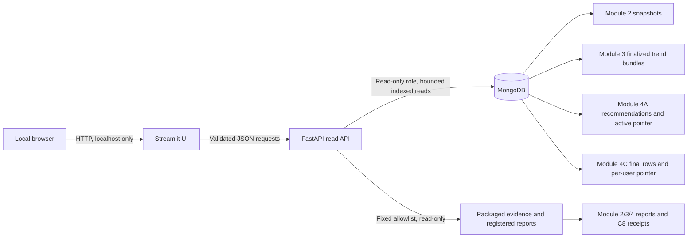

# Module 4D Dashboard Architecture Plan

## Purpose and boundary

This document defines the D0 design for a read-only dashboard over the data that
Modules 2, 3, 4A–4B, and 4C actually persist. It does not add an API, dashboard,
dependency, or production-code change. The data inventory and field-level
contracts are in [module4d-data-contracts.md](module4d-data-contracts.md).

## Implementation status update

The D0 design has since been implemented through D1A (verified read-only
recommendation and trend API), D1B (batch analytics and curated evidence API),
and D2A (the first three Streamlit pages documented in
[`module4d-streamlit.md`](module4d-streamlit.md)). The backend and UI now live
under `src/module4/dashboard/`; the Hybrid reader uses `src/module4/hybrid/`.
D2B implemented and validated the fourth Evaluation & Performance page using
the accepted archived evaluation and evidence API contracts. D3 packaged the
loopback-only Compose demo and verified the synthetic publisher fixture,
read-only FastAPI path, and browser flow. Observed evidence and limits are in
[`module4d-release-review.md`](module4d-release-review.md).
D0 route proposals below are historical design context; the
implemented D1A/D1B routes documented in [`module4d-api.md`](module4d-api.md)
take precedence. The D1A/D1B dependencies are pinned in
[`deploy/module4/requirements/api.txt`](../deploy/module4/requirements/api.txt), and UI
dependencies are pinned separately in
[`deploy/module4/requirements/ui.txt`](../deploy/module4/requirements/ui.txt).

The design follows [Proposal §30](Proposal.md),
correcting its collection summaries where current code differs. In particular,
department/hour/day reports are local Module 2 artifacts; the immutable trend
bundle collection is separate from the legacy mutable trend collection; and
Hybrid recommendations are selected through per-user readiness pointers.

## Recommendation

Use a small FastAPI read API and a Streamlit dashboard. Streamlit calls the API
over HTTP; only the API connects to MongoDB or opens registered report files.
Use the synchronous PyMongo client managed by FastAPI application lifespan and
its connection pool. The expected request and row volumes are low, and this
avoids adding an async Mongo client.

This fits the existing Python, PyMongo, pandas, and requests stack and is easy
to demonstrate locally. FastAPI provides typed request validation, explicit
response schemas, OpenAPI documentation, and a testable boundary around the
database. Streamlit supports tables and interactive charts with little UI
boilerplate. At D0, the current [requirements.txt](../requirements.txt) did not
include FastAPI, Uvicorn, Streamlit, or a chart library. D1A/D1B added pinned
FastAPI and Uvicorn dependencies in the API-specific requirements file;
Streamlit remains deferred. Streamlit's built-in charts and pandas tables
should cover the first release without Plotly.

| Choice | Benefits for this repository | Cost or limitation |
|---|---|---|
| FastAPI API | Python validation and serialization; explicit API contract; easy endpoint tests; Mongo credentials stay server-side | Adds FastAPI and an ASGI server; read-only role and query limits still need configuration |
| Streamlit UI (recommended) | Python-only UI; quick academic demo; built-in tables and charts; calls the same API contract used by tests | Adds Streamlit; layout and fine-grained interaction are less flexible than a custom SPA |
| React UI | Flexible interactions, richer chart ecosystem, independently deployable frontend | Adds a JavaScript toolchain, API client and build pipeline; higher maintenance for the current small demo |
| Streamlit direct to MongoDB | Fewer processes | Rejected for the design: exposes database configuration to the UI tier and bypasses the API's read validation and consistency rules |

## Component view

The dashboard services must not start Spark, Kafka, HDFS, or a module runner.
The API uses MongoDB only for reads and reads reports only from an
administrator-configured registry rooted at packaged evidence. User input is
never interpreted as a database filter, collection name, report path, or sort
field.

## MVP pages

The first release has three pages. Offline model evaluation and detailed
benchmark comparisons are designed as a later evidence page so the first
iteration stays focused on the live analytical outputs and per-user serving
result.

| Page | User purpose and content | Sources and filters | Refresh and empty/error behavior | Acceptance |
|---|---|---|---|---|
| **Overview** | See which Lambda outputs are readable and the source identities/timestamps behind them. Show the highest retained event-time trend window for the configured namespace, batch snapshot `run_id`s, active A/B readiness identity, and the current report-evidence availability. | Bounded `/overview` reads; configured trend namespace; active readiness point lookup; fixed evidence registry. | Loading shows per-source progress. Refresh on demand or every 30 seconds. A missing optional source is a labeled unavailable card; Mongo failure is a page-level service error with request ID. `observed_at` is dashboard observation time, not event time. The trend card is selected by event-time order, not recent publication time. | No page load starts compute services. Each value includes source and observation/provenance metadata; the page does not assert that all collections share one publication transaction. |
| **Realtime and batch** | Inspect finalized Top-K scores and batch purchasing patterns. Charts show trend score across returned finalized windows, top purchased products with reorder rate, department totals, order counts by hour/day-of-week, the available department/hour and department/day reports, and registered streaming progress summary cards (input/processed rows/s and trigger/addBatch durations) when present. Mongo batch rows expose product/department IDs; names appear only when supplied by the registered report. | `/trends`, `/batch/products`, `/batch/departments`, `/reports/module2/{run_id}`, and the allowlisted evidence route for a registered Module 3 summary. Filters: configured namespace, event-time range (at most 31 days and at most 50 windows), product sort enum, fixed allowlisted report/run. | Loading shows the selected source. No automatic claim of a live/open window. Refresh on demand or every 30 seconds for Mongo data. Report values are immutable for a registered run. Empty time range returns an empty state with retention context. Missing progress summary or Parquet/report is labeled unavailable, never guessed; historical progress is labeled historical. | Every trend point has window bounds, namespace, original `source_scope`, and source `published_at`. Order counts are labeled as orders; prior-only purchase counts and synthetic dates are labeled as such. Progress metrics show the run and inclusion/method notes. |
| **User recommendations** | Compare an individual user's ALS list and final Hybrid Top-K with raw/normalized components, final score, rank, inclusion flags, selected serving version, and fallback explanation. | `/users/{user_id}/recommendations`; positive integer ID only; top K is fixed by the accepted source contract and capped at 20. | Loading appears after submit. No background publication. Empty but ready Hybrid snapshot is a valid `200` with mode/reason. Missing or non-ready pointer is an explicit unavailable response. Pointer change during a read returns a retryable consistency error. | The Hybrid list is accepted only after readiness, exact version/user rows, row-count/rank validation, and pointer identity recheck. ALS comparison is shown only for the same model version and a stable A/B readiness read. |

The D2 **Evaluation and performance evidence** page can show Module 4A's
persisted offline metrics, Module 2 join/pruning/cache trials, Module 3
streaming progress summaries, Module 4A–4B stage/shuffle evidence, and the
controlled C8A/C8B Module 4C receipts. It must identify dataset/run, environment,
method, scope, and limitations beside each number. It must not render Hybrid
accuracy or call C8A/C8B synthetic timings production latency.

## HTTP contract

Prefix all routes with `/api/v1`. Responses are JSON and include a
`source`/`provenance` object and `observed_at` where data is returned. MongoDB
timeouts and internal paths/credentials are not returned to clients.

| Route | Inputs and response shape (bounded) | Read/query contract | Errors |
|---|---|---|---|
| `GET /health/live` | No inputs; `{ "status": "ok" }` | Process liveness only; no dependency calls | `503` only when process cannot serve |
| `GET /health/ready` | No inputs; `{ "status", "mongo", "report_registry" }` with booleans/enums only | Mongo ping with a short timeout; verify the configured report registry without scanning data collections | `503 service_unavailable`; no URI or host details |
| `GET /api/v1/overview` | No client-supplied query; `{observed_at, sources:{name:{available,reason,run_id,version,timestamps}}}` with no item arrays | Point lookup of `module4_snapshot_readiness` `_id="active"`; one configured namespace prefix range on trend bundle `_id`, sort descending, limit 1 (highest retained event-time); fixed report registry metadata. Batch endpoint metadata may be omitted if not read in this request. | `200` with per-source unavailable states; `503` if required Mongo connection fails |
| `GET /api/v1/trends?source_namespace=…&from=…&to=…&limit=…` | Namespace must be in server allowlist; UTC timestamps; `from <= to`; range ≤31 days; `1 <= limit <= 50`; `{source_namespace, windows:[{window_start,window_end,source_scope,published_at,expires_at,row_count,items:[...] }], observed_at}`; at most 1,000 embedded item rows | Compute the stored namespace SHA-256 prefix and range-query the deterministic string `_id` using `$gte`/`$lte`; sort `_id` descending and limit. The `_id` index is the access path. Verify `source_namespace` and window identity on every result. | `422 invalid_filter`; `200 []` with retention/availability metadata; `503 service_unavailable`; `502 invalid_source_document` |
| `GET /api/v1/batch/products?order=top_purchased&limit=…` | `order` is a fixed enum; `1 <= limit <= 20`; `{items:[{product_id,purchase_count,unique_users,reorder_count,reorder_rate,run_id,last_batch_time}],observed_at}` | `batch_product_metrics.find({}).sort({purchase_count:-1}).limit(limit)` uses the existing `purchase_count` index as a bounded top-K index walk. Return only declared fields and per-row `run_id`. A D1 compound index on `(purchase_count desc, _id asc)` is required if deterministic tie selection is required. | `422 invalid_filter`; `200 []`; `503 service_unavailable` |
| `GET /api/v1/batch/products/{product_id}` | Positive decimal integer; `{product_id,purchase_count,unique_users,reorder_count,reorder_rate,run_id,last_batch_time}` | Exact `_id=product_id` lookup on Mongo's default `_id` index; product name is not present in this collection. | `422 invalid_id`; `404 product_metric_not_found`; `503 service_unavailable` |
| `GET /api/v1/batch/top-reordered?limit=…` | `1 <= limit <= 20`; `{items:[product report rows],minimum_reorder_support,run_id,provenance}`; threshold fixed to the report's recorded value unless a versioned configuration is registered | MVP reads `top_reordered` from a fixed Module 2 `analytics.json` report; this exactly preserves the Spark threshold and tie-break. If live Mongo ranking is required later, add a matching support-aware compound/partial index and validate it with `explain` before enabling that query. | `404 report_not_registered`; `503 report_unavailable`; do not silently use a different threshold |
| `GET /api/v1/batch/departments` | No input; `{items:[{department_id,purchase_count,unique_users,reorder_rate,run_id,last_batch_time}],observed_at}`; at most 21 rows | `$in` on the fixed department ID list (currently 1–21) against `department_metrics._id`, bounded to 21 point keys using the default `_id` index. | `200 []` only if source is genuinely empty; source/run mismatch is reported as inconsistent; `503 service_unavailable` |
| `GET /api/v1/reports/module2/{run_id}` | `run_id` must resolve through a server-side allowlist; no path component; `{run_id,scope,counts,top_purchased,top_reordered,orders_by_hour,orders_by_dow,department_hour,department_day,provenance}` with field/row caps | Read fixed `analytics.json`, and optional `department_hour_metrics` / `department_daily_trends` Parquet entries associated with that run. File size, row count, selected date range, and response rows are capped. Never join HDFS or start Spark from a request. | `404 report_not_registered`; `503 report_unavailable`; `422 invalid_filter` |
| `GET /api/v1/users/{user_id}/recommendations` | Positive decimal integer; `{user_id,als:{model_version,items:[...]},hybrid:{serving_version,mode,reason,source,items:[...]},observed_at}`; response capped at 20 ALS and 20 Hybrid rows | See the [Hybrid consistency protocol](#hybrid-recommendation-consistency-protocol). ALS rows also use exact model/user keys, rank sort and a 21-row limit. | `422 invalid_id`; `404 recommendation_snapshot_not_found`; `503 snapshot_not_ready` or `service_unavailable`; `409 snapshot_changed`; `502 invalid_snapshot` |
| `GET /api/v1/evidence/{report_id}` (D1 API, D2 UI) | `report_id` is an allowlisted opaque key; optional fixed section enum; `{report_id,section,data,provenance,source_hash}` with response bytes/fields capped | Read only registered summary/evaluation/performance JSON or sanitized receipts. No dynamic paths or raw report passthrough. | `404 report_not_registered`; `503 report_unavailable`; `422 invalid_section` |

All Mongo filters are constructed from validated scalar values and fixed field
names. Inputs containing Mongo operators, object-valued IDs, arbitrary sort
expressions, collection names, or paths are rejected. All cursors have an
explicit result limit and are closed. Set server-side `maxTimeMS`, a bounded
server selection timeout, response-size limits, and request timeouts. Index
requirements and current gaps are listed in the data contract.

### Hybrid recommendation consistency protocol

For `user_id`, read the exact readiness point `_id="hybrid:<user_id>"` from
`module4_snapshot_readiness`. Require `status="ready"`, `ready=true`, a
well-formed `serving_version`, and `expected_rows` in `[0,20]`. Query
`final_recommendations` with the exact `user_id` and `serving_version`, sort by
`rank`, and call `.limit(21)` to detect overflow. Require exactly
`expected_rows` documents, unique product IDs, and unique contiguous ranks
`1..expected_rows`. Read the same pointer again and compare its identity fields
(`_id`, user, status/ready, serving version, row count, source run/model/graph,
trend namespace/window/hash, input/config digests, and update time). Accept only
when the pointer is unchanged. The row query uses the unique
`(serving_version,user_id,rank)` index; readiness uses the default `_id` index.

Never select “latest” recommendation rows without the per-user pointer. Never
substitute the Module 4A–4B `_id="active"` pointer for the Hybrid pointer. The
Hybrid pointer may reference a valid older A/B generation; render its stored
source identities. For an ALS side-by-side list, read `_id="active"` before and
after the ALS row query, query the exact model version named by the Hybrid
pointer, and show that comparison only if the active model still equals that
version and the pointer did not change. Otherwise keep the Hybrid result and
mark the ALS comparison unavailable.

| Condition | API/UI behavior |
|---|---|
| Invalid user ID | `422 invalid_id`; no database query |
| No per-user pointer | `404 recommendation_snapshot_not_found`; wording says no published snapshot was found, not that the person is not a known dataset user |
| Pointer exists but is not ready or malformed | `503 snapshot_not_ready`; do not guess that it is currently publishing |
| Ready pointer with `expected_rows=0`, valid empty row set | `200`, empty list with `mode` and required `reason` |
| Row count, product uniqueness, or ranks fail validation | `502 invalid_snapshot`; do not return partial rows |
| Pointer identity changes between reads | `409 snapshot_changed`; client may offer one manual retry |
| Mongo connection or timeout failure | `503 service_unavailable`; return a request ID, not connection details |

The publisher does not persist an explicit intermediate `publishing` pointer.
Therefore the reader cannot distinguish a publication in flight from a user
that has never received a snapshot when the pointer is absent. The API must use
the unavailable semantics above.

## Time and provenance rules

Every response keeps the source's own timestamps separate:

| Name | Meaning |
|---|---|
| `event_time` / window bounds | Time represented by the input events. Trend windows are finalized event-time windows. |
| `processed_at` / progress duration | Spark processing or trigger measurements from a particular run; not a Kafka lag measure. |
| `published_at` | Time a trend bundle was published to MongoDB. |
| `generated_at` | Time the selected recommendation snapshot was generated. |
| `observed_at` | Time the API observed the source while answering the request. |

Keep `source_namespace` and the original `source_scope` verbatim. A historical
synthetic/replay window is labeled historical or synthetic from its provenance;
an old event-time date alone does not make a retained record stale. State the
bundle expiry/retention boundary separately. A recommendation fallback is
explained from its persisted `mode` and `reason`; a dashboard read never calls
the Module 4C publication CLI or service.

## Performance and resource rules

- Set hard endpoint limits: trend query at most 50 windows/1,000 item rows;
  product lists at most 20; departments at most 21; per-user result at most 20
  rows per algorithm; local report request at most one registered run and a
  bounded date range.
- Use the exact indexes listed in [module4d-data-contracts.md](module4d-data-contracts.md).
  Add and verify a compound product index before promising deterministic sorted
  top-purchased output. Do not query the current snapshot by an unindexed
  `run_id` predicate.
- Do not aggregate raw event collections, call Spark, or scan HDFS in a request.
  Data not present in Mongo or a registered bounded report is unavailable.
- Keep request-level database work finite using indexes, cursor limits,
  `maxTimeMS`, and one retry at most for a changing pointer.
- Cache static evidence by report ID and content hash. Do not cache readiness or
  recommendation results across requests; refresh them under their pointer
  protocols.
- Keep charts small and paginate nowhere in the MVP. If a later view needs
  broader history, add a purpose-built materialized read model with its own
  reviewed publication contract.

## Security and deployment

This is an academic demonstration. A localhost-only deployment may omit user
authentication only when both UI/API host ports bind to `127.0.0.1`. Any shared
or network-accessible deployment requires authentication and authorization,
TLS, and rate limits. Do not expose the API or UI on `0.0.0.0` at the host.

Use a dedicated MongoDB account with read access only to the required database
and collections. The current [compose.yaml](../compose.yaml) has an unauthenticated
MongoDB service for local development; D1 must either add a read-only dashboard
account without changing the existing module writers, or document that the
demo is isolated to localhost. Pass the URI through backend environment or a
Compose secret. Never put it in Streamlit settings, browser code, logs,
exceptions, or API responses.

Add separate API and UI services under an opt-in Compose profile. Only the API
depends on healthy MongoDB. The UI depends only on the API. Do not declare
dependencies on Spark, Kafka, or HDFS. Put the API and MongoDB on a scoped
dashboard network; the UI reaches the API but has no Mongo route. Bind the host
port to loopback. Build a small dashboard image; include only app code and the
allowlisted sanitized evidence files. Do not mount the repository, `results/`,
Docker socket, HDFS data, Kafka data, or unrelated Compose volumes. If a report
mount is required in development, mount only the configured evidence directory
read-only.

The backend report registry maps opaque report IDs to fixed, relative packaged
files. Validate the resolved path stays under the configured evidence root,
reject symlinks and arbitrary user paths, cap file size, and project only
allowlisted fields. Store report provenance and source hashes in responses.

## Test strategy for implementation

No tests are run for D0. D1–D3 should add tests at the contract boundaries:

- Unit tests for request validation, scalar-to-filter translation, namespace
  identity construction, report allowlists, response projection, and error
  redaction. Include Mongo-operator strings, wrong types, oversized limits,
  invalid timestamps, and paths outside the evidence root.
- Fake-collection tests proving each access path has exact predicates, an
  explicit limit, stable sort, and no write method invocation.
- Isolated Mongo integration tests for indexes and bounded query behavior;
  Module 4C tests for absent, empty-ready, malformed, and changing per-user
  pointers; Module 4A tests for active pointer changes.
- API contract tests for error codes, source metadata, and maximum response
  sizes; UI tests for loading, empty, unavailable and retry states.
- Compose config validation and a smoke test proving dashboard startup does not
  start Spark/Kafka/HDFS and does not mount unrelated volumes.
- Keep the existing module suites unchanged and run them only as part of the
  implementation milestones' explicitly requested validation.

## Milestones

### D1 — Read-only API foundation

Implement the API schemas, Mongo lifespan, read-only configuration, evidence
registry, health endpoints, bounded trend/batch reads, and the per-user ALS and
Hybrid snapshot reader. Add any required indexes as an explicit migration or
startup preflight that refuses an unsafe query plan. Keep all publication
commands out of the API package.

**Acceptance:** source and endpoint contract tests pass; API uses only fixed
collections/fields and scalar validation; all Mongo requests are read-only,
bounded, indexed, and time-limited; Hybrid pointer protocol and empty/error cases
pass; errors contain no credentials or filesystem paths; no Spark/Kafka/HDFS
startup or dependency is added to API requests.

### D2 — MVP Streamlit pages and evidence views

Implement Overview, Realtime and batch, and User recommendations pages against
the API. Add allowlisted Module 2/3/4 evidence endpoints and the Evaluation &
Performance evidence page only after the report registry is defined and report
fields are verified. D2A delivered the first three pages; D2B delivered the
fourth page over the existing read-only evaluation, registry, and curated
evidence endpoints.

**Acceptance:** every displayed metric has source/run/method/scope; missing data
is shown as unavailable; there are no unsupported accuracy, lag, or latency
claims; historical synthetic data is labeled; user explanations match the
persisted Hybrid rows; UI carries no Mongo credentials and makes no publisher
calls.

### D3 — Reproducible demo and review (implemented)

Package API/UI in a task-scoped Compose file with loopback binding, scoped
database and frontend networks, read-only Mongo credentials, packaged evidence,
and no unrelated mounts. Document startup and cleanup.

**Acceptance:** Compose configuration is valid; an isolated smoke proves UI to
API to Mongo/report reads; the read-only account rejects a write; opening or
refreshing the dashboard does not start Spark, Kafka, or HDFS; service health,
empty states, shutdown, and report provenance are documented. The release
review records the MongoDB 7.0.16 fixture, route responses, browser run, and
regression results. CI keeps the required `fixtures` check and runs the UI and
browser checks after it.

## Known limits and operational notes

1. **Trend bundle enablement and namespace:** `publish_trend_bundles` defaults
   false. The deployment must explicitly enable it and provide a stable,
   allowlisted namespace; otherwise the finalized bundle view reports
   unavailable. The mutable `realtime_trending` collection is not a safe
   replacement for the immutable bundle reader.
2. **Report registry and retention:** only reviewed files in the fixed evidence
   registry ship in the API image. Do not make arbitrary generated result paths
   discoverable.
3. **Module 2 sorted read indexes:** the dashboard requires the compound
   purchase-count and reorder-rate ranking indexes documented in the migration
   guide. Module 2 publication replaces the product collection and its
   indexes, so administrators must re-provision both before serving dashboard
   reads.
4. **Batch cross-collection publication:** Module 2 atomically replaces each
   output collection separately, not as one transaction. Expose and compare
   `run_id`s; never label two collections as one coherent generation when IDs
   differ.
5. **Trend retention:** trend bundle TTL is based on processing-time
   `expires_at`, normally seven days but configurable or disabled. Historical
   event-time does not establish expiry. API responses must describe actual
   missing/expired availability without inferring from the event date.
6. **Unknown user versus unpublished user:** current collections do not provide
   a separate canonical user-directory query for this API. A missing pointer
   means “no published snapshot found,” not a verified unknown user.
7. **Hybrid quality and historical ranking:** no leakage-safe Hybrid quality
   evaluation or live per-user before/after trend history exists. C8A is a
   fixed synthetic responsiveness experiment only.
8. **Deployment scope:** localhost binding is acceptable for a supervised
   academic demonstration. Any shared deployment requires an authentication
   provider and authorization policy that are outside the current repository.

## D0 acceptance checklist

- [x] Architecture and frontend choice are justified against repository stack.
- [x] MVP pages and API contracts name exact data sources and bounded queries.
- [x] Hybrid reads honor the per-user pointer protocol and distinguish the A/B
  `active` pointer.
- [x] Missing and unavailable metrics, provenance, security, Docker constraints,
  tests, milestones, acceptance criteria, and risks are recorded.
- [x] No application code, dependency, or accepted Module 4C source was changed.
